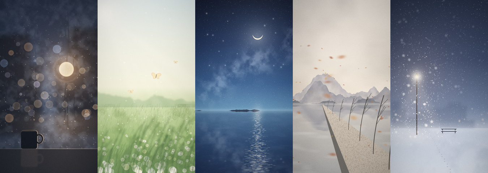

# 歌曲 MV 背景图（竖版 9:16 · 1080×1920）

电影感、极简的风景画面，共 5 张：用焦外光斑、雾气、景深、逆光和胶片颗粒来营造情绪，不画卡通轮廓。
5 张统一做了哑光调色和留白，方便叠加歌词；画面里没有文字、水印和 logo，也没有人物。



| # | 文件 | 对应歌词 | 画面 |
|---|------|----------|------|
| 1 | `01_巷口暖灯.jpg` | 巷口灯光忽明忽灭 / 手中甜咖啡已冷却 / 在发呆的窗前凝结 | 隔着起雾、挂着水珠的窗玻璃看夜色，巷口路灯化成一团暖色光斑，远处窗灯虚成光点；窗台上一只逆光的杯子，没有热气 |
| 2 | `02_春日蝴蝶.jpg` | 你看啊春日的蝴蝶 / 颤抖着飞越 / 和风与暖阳倾斜 | 左上角斜射的暖阳和光束，草叶被风吹向一边、近处虚化，草地上有野花光斑和斑驳花影，几只淡黄的蝴蝶飞过 |
| 3 | `03_仲夏弯月.jpg` | 你看啊仲夏的弯月 / 倒挂天际的笑靥 | 澄澈的夜空和淡淡的银河，一弯两角朝上、像笑脸的细月，镜面般的水面映着星空和碎银般的月光 |
| 4 | `04_秋末长堤.jpg` | 你听啊秋末的落叶 / 叹息着离别 / 海与山 风和月 | 雾气里层层远山，平静的海面，一条空荡荡的长堤伸向远方，堤上的细树被风吹弯，橙色落叶随风飞过 |
| 5 | `05_冬至白雪.jpg` | 你听啊冬至的白雪 / 掩饰着哽咽 / 再没有你的冬眠 | 蓝调时刻的雪夜，一盏安静的街灯，灯光锥里的雪更亮；一条覆雪的长椅和一串走远的脚印，上方大面积留白 |

## 重新生成 / 调整

```bash
python3 paint.py            # 重画全部 5 张（需要 numpy、Pillow）
python3 paint.py 03         # 只重画名字里带 "03" 的那张
```

每张图由 `paint.py` 里对应的 `scene_*` 函数绘制，颜色都写成十六进制，改色值即可调色；随机种子固定，结果可复现。

## AI 绘图提示词（可选）

如果想用 Midjourney / 即梦 / 可灵 / Stable Diffusion 生成更写实细腻的版本，可以用下面这套提示词。统一的风格后缀能让 5 张保持一致：

**统一风格后缀**：`cinematic still, minimalist composition, shallow depth of field, soft natural light, muted film color grading, subtle film grain, generous negative space, airy and clean, no people, no text, no watermark, no logo --ar 9:16`

1. 雨夜窗边，玻璃上有雾气和水珠，窗外巷口一盏暖黄路灯虚化成大光斑，远处窗灯化作点点焦外光斑；窗台上一只逆光的马克杯，咖啡已经冷了、没有热气；深蓝与暖橙的冷暖对比
2. 春日午后，暖阳从左上角斜照，光束里飘着花粉，草叶被和风吹向一侧，前景草叶虚化，草地上有野花焦外光斑和斑驳花影，几只淡黄的蝴蝶飞过，清新明亮
3. 仲夏夜，澄澈的深蓝夜空和淡淡的银河，一弯两角朝上的细月像微笑，平静如镜的湖面倒映星空，月光在水面碎成银色的一条
4. 秋末阴天，薄雾里层层远山，海面平静，一条空旷的长堤伸向远方，堤上一排细树被风吹弯，几片橙色落叶在风中飞过，低饱和的灰调中带一点暖橙
5. 冬至蓝调时刻，大雪中一盏安静的街灯，暖光锥里的雪花被照亮，覆雪的长椅，一串走远的脚印，远处楼宇隐在雪雾里，上方大面积留白
